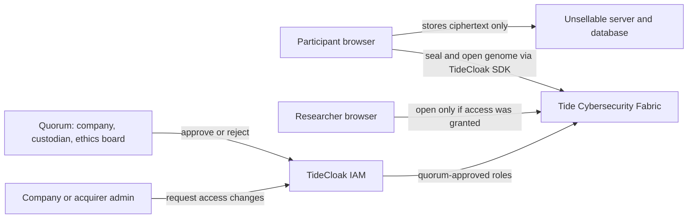
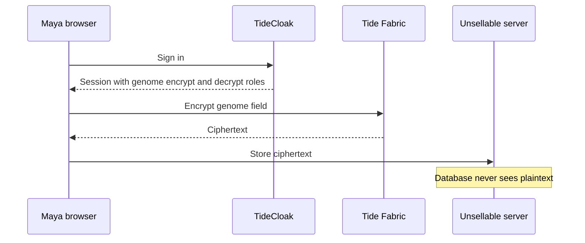
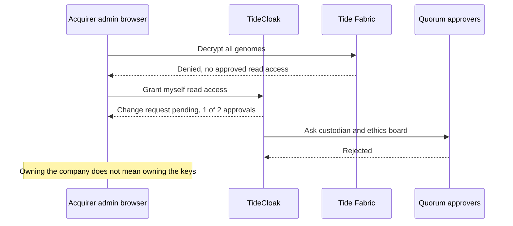

# Unsellable

[](https://tide.org/tidecloak?utm_source=github&utm_medium=readme&utm_campaign=unlocked)

## Project overview

**Unsellable is a genetic data platform where your DNA cannot be sold, transferred or exported with the company, because no admin, acquirer or AI ever holds the key.**

Built with [TideCloak](https://tide.org/tidecloak?utm_source=github&utm_medium=readme&utm_campaign=unlocked).

### 1. Vision & originality

Genetic testing and biobanks power medical discovery, but participants must trust one company forever, including whoever buys it next. Unsellable separates custody from ownership: the company runs the service, while authority over each genome stays with participants and independent custodians. Selling the company sells servers and ciphertext, not access.

### 2. Trust constraint insight

In 2025, a court approved transferring bankrupt 23andMe's customer genetic data to its $305M buyer; 1.9 million people requested deletion. In 2026, UK Biobank paused research access after data released to researchers appeared for sale online. Whoever controls the company controls the keys, so people withdraw and custodians lock research down. Remove that single point of control and genetic data stays useful without being for sale.

### 3. Value & impact

Participants can contribute DNA knowing an acquisition, rogue admin or breach cannot take it. Companies offer a verifiable guarantee instead of a privacy policy. Example: Maya's genome stays hers even after "Acquirer Corp" takes over every server.

### 4. Why TideCloak matters

Genomes are sealed with TideCloak's Hermetic E2EE: plaintext only appears in an authorised user's browser, never on our server. Read access is granted only through quorum-enforced governance where independent custodians hold the majority, so an acquirer inheriting admin seats cannot grant itself access. With ordinary backend permissions, that admin could simply export everything.

### 5. Prototype & storytelling

Watch for: Maya seals and views her genome; the database holds only ciphertext; Acquirer Corp's admin clicks "Export all" and is denied; granting itself read access stays pending until the custodian and ethics board decide.

<!-- TODO(team): the overview above is under 300 words. Re-count after any edit. Only describe what the prototype actually does. -->

## Setup

<!-- TODO(team): replace every step below with the exact commands your build uses, then run through it once on a clean machine. -->

### Prerequisites

| Tool | Version | Why |
|---|---|---|
| Docker | Recent stable | Runs the TideCloak development server |
| Node.js | 18.18 or newer | Runs the Next.js app |
| npm | Bundled with Node.js | Installs dependencies |
| A modern browser | Chrome, Edge or Firefox | Decryption happens in the browser |

### 1. Start TideCloak (development mode)

```bash
docker run -d --name tidecloak -p 8080:8080 \
  -e KC_BOOTSTRAP_ADMIN_USERNAME=admin \
  -e KC_BOOTSTRAP_ADMIN_PASSWORD=change-me \
  tideorg/tidecloak-dev:latest
```

Open `http://localhost:8080` and sign in to the admin console. These bootstrap credentials are for local development only.

### 2. Configure the realm

Follow the [TideCloak Quickstart](https://docs.tide.org/get-started/Tidecloak%20Quickstart) (or ask Tide's MCP server in your coding agent) to:

1. Activate the development licence and create a realm named `unsellable`.
2. Register the web client used by the app.
3. Create the field roles for genomes: `_tide_genome.selfencrypt` and `_tide_genome.selfdecrypt`.
4. Create the demo users listed below and assign their roles.
5. Nominate exactly **three** quorum administrators: `admin.company`, `custodian` and `ethics` (see [Governance design](#governance-design-who-sits-in-the-quorum)).
6. Download the client adapter configuration and save it as `app/tidecloak.json` (not committed). In the client, allow redirect URI `http://localhost:3000/*` and web origin `http://localhost:3000`.

### 3. Run the app

```bash
cd app
npm install
npm run dev
```

Open `http://localhost:3000`. If the page says "TideCloak not configured", `app/tidecloak.json` is missing.

There is no seed script: real ciphertext can only be produced in a signed-in browser. Sign in as `maya` and press "Seal genome" to create the first record. The server stores it in `app/data/genomes.json`.

### Demo accounts

| Username | Role in the story | Can do |
|---|---|---|
| `maya` | Participant | Seal and view her own genome, set consent preferences |
| `lee` | Researcher, cancer study | Read only what the quorum has approved |
| `admin.company` | Company administrator, quorum seat 1 | Run the service; one approval out of three |
| `admin.acquirer` | New owner's administrator after the sale | Full app admin; no ability to read genomes |
| `custodian` | Independent data custodian, quorum seat 2 | Approve or reject access changes |
| `ethics` | Independent ethics board, quorum seat 3 | Approve or reject access changes |

All people, genomes and organisations in this repository are synthetic.

### Troubleshooting

- TideCloak setup issues: ask in the `#support` channel of the [Tide Discord](https://discord.gg/XBMd9ny2q5) with your error and what you tried.
- Integration questions: connect [Raziel, Tide's MCP server](https://docs.tide.org/ai-agent-pack), to your coding agent.

---

# Detailed documentation

The sections below go deeper than the 300-word overview, for judges and reviewers who want the full reasoning.

## Contents

- [The problem in one picture](#the-problem-in-one-picture)
- [What actually happened](#what-actually-happened)
- [Problem statement](#problem-statement)
- [What Unsellable makes possible](#what-unsellable-makes-possible)
- [Who uses it](#who-uses-it)
- [How it works](#how-it-works)
- [TideCloak features we rely on](#tidecloak-features-we-rely-on)
- [Governance design: who sits in the quorum](#governance-design-who-sits-in-the-quorum)
- [Threat model](#threat-model)
- [Would it work without TideCloak?](#would-it-work-without-tidecloak)
- [Demo walkthrough](#demo-walkthrough)
- [Data model](#data-model)
- [Prototype status](#prototype-status)
- [Limitations and open questions](#limitations-and-open-questions)
- [Roadmap](#roadmap)
- [How we built it](#how-we-built-it)
- [References](#references)

## The problem in one picture

Think of a safe deposit box at a shop.

- **Today:** the shop owner keeps a master key. If the shop is sold, the master key is sold with it, and the new owner can open any box.
- **With Unsellable:** no complete key exists anywhere. Opening a box for anyone other than its owner needs signatures from two of three independent keyholders: the shop, an outside custodian and an ethics board. If the shop is sold, the new owner inherits one signature, which is not enough.

Genetic data makes this especially serious:

- **It cannot be changed.** A leaked password can be reset; a leaked genome cannot.
- **It is not only yours.** Your DNA reveals information about parents, siblings and children who never took a test.
- **It is valuable.** Large genetic datasets are raw material for drug discovery, so there is always a buyer.

## What actually happened

### 23andMe: legal transfer, not a hack

| When | What happened |
|---|---|
| 2023 | A months-long breach exposed personal and genetic data of 6.9 million customers. |
| March 2025 | 23andMe filed for bankruptcy and put the company, including the genetic data of its 15 million customers, up for sale. |
| By June 2025 | About 1.9 million people, roughly 15% of customers, asked for their genetic data to be deleted. |
| June 2025 | More than two dozen states sued 23andMe to challenge the sale of customers' private data. |
| June 2025 | TTAM Research Institute, a nonprofit led by the former CEO, outbid Regeneron. |
| July 2025 | The bankruptcy court approved the $305M purchase **and the transfer of customers' genetic data** to the buyer, overruling the states' objections. |

Nothing here required an attacker. The data changed hands because the company did. Customers' only real option was to delete their data, which also removed it from research.

### UK Biobank: approved access, then a lockdown

In April 2026, UK Biobank data held by three research institutions was offered for sale on a site owned by Alibaba. The de-identified data covered all 500,000 volunteers. UK Biobank temporarily paused researcher access while it investigated.

### The common pattern

When people cannot trust who controls the keys, the data is either **pulled out** (23andMe deletions) or **locked down** (UK Biobank's pause). Both outcomes slow medical research.

## Problem statement

> Today, whoever owns the company owns the keys. Every privacy promise is only as durable as the company's ownership: if the company is sold, goes bankrupt or is taken over, the promise changes hands with it. How can a company run a genetic data service without the power to unlock people's DNA being part of what it can sell?

## What Unsellable makes possible

| Today | With Unsellable |
|---|---|
| A privacy policy is a promise that the next owner can reinterpret | Custody is enforced by cryptography and governance that the next owner does not control |
| Participants' safest choice is to delete their data | Participants can stay in research because exit is not their only protection |
| Custodians respond to misuse by shutting down access for everyone | Access is granted per decision by independent parties, so trust does not hinge on one operator |
| Acquirers price in the database as an asset | Acquirers buy a service, not unrestricted access to genomes |

## Who uses it

| Persona | Need | What Unsellable gives them |
|---|---|---|
| **Maya, participant** | Contribute to research without her DNA becoming a sellable asset | Her genome is sealed; reading it requires her session or an independent quorum decision |
| **Dr. Lee, researcher** | Access to well-governed data for a cancer study | Access granted by named, independent approvers, which is easier to defend to ethics committees and participants |
| **Genetic testing startup** | Win customers who saw what happened to 23andMe | A guarantee customers can verify rather than a policy they must trust |
| **Independent custodian and ethics board** | Oversight that cannot be bypassed | A required signature on every access change |

## How it works

### Architecture



Key properties:

- The **server and database only ever store ciphertext**. They have no key to decrypt it.
- **Decryption happens in the browser** of an authorised user. The Fabric re-encrypts the result to that user's session key, so plaintext never exists on a server.
- **Who may read what** is defined by roles that can only change through **quorum approval**.

### Flow 1: Maya seals her genome



### Flow 2: Acquirer Corp tries to take the data



## TideCloak features we rely on

| TideCloak feature | Where it appears in Unsellable | What it guarantees |
|---|---|---|
| **Hermetic E2EE** | Sealing and opening genome fields | Plaintext exists only in the authorised user's browser; servers, admins, cloud providers and Tide cannot decrypt |
| **Role-gated encrypt and decrypt** | `_tide_genome.selfencrypt` and `_tide_genome.selfdecrypt` | Encrypt and decrypt endpoints check for the matching role before running |
| **Quorum-Enforced Governance** | Any change to who may read genomes | Granting these roles is a governed change that goes through quorum approval instead of applying immediately |
| **Ineffable keys on the Fabric** | All cryptographic operations | Each key is split across 20 independently operated nodes; no single node, operator, admin or Tide holds a whole key |
| **Tamper-proof authorization** | Every request to the Fabric | Tokens are signed by a distributed key, so a compromised server cannot forge permissions |
| **BYOiD authentication** | Sign-in for every persona | No password hash stored by the app or TideCloak |

## Governance design: who sits in the quorum

TideCloak's quorum threshold for administrative changes is roughly 70% of nominated administrators: `threshold = max(1, floor(N × 0.7))`.

| Number of admins | Threshold | Seat split | Can the company (or acquirer) act alone? |
|---|---|---|---|
| 1 | 1 | Company only | **Yes**, the design fails |
| 2 | 1 | Company and custodian | **Yes**, either admin alone meets the threshold |
| **3** | **2** | **Company, custodian, ethics board** | **No**, at least one independent party must agree |
| 5 | 3 | Company plus four independent parties | No, at least two independent parties must agree |

We use **three** administrators. The company keeps a seat so it can operate the service, but independent parties hold the majority. When the company is sold, the acquirer inherits one seat out of three.

In the prototype, all three quorum accounts are created by our team on one machine to simulate independent organisations. In production, each seat would belong to a separate legal entity, for example a data trust and a university ethics board.

## Threat model

| Actor | Ordinary app | Unsellable | Why |
|---|---|---|---|
| Database thief | Gets genomes | Gets ciphertext | Data is sealed before it reaches the database |
| Our own server, fully compromised | Attacker reads data and keys | Attacker finds no keys and no plaintext | The server holds no decryption authority |
| Rogue company admin | Queries and exports everything | Cannot decrypt; cannot grant itself access alone | Read access needs quorum approval |
| **Acquirer after a sale** | Inherits full access | Inherits one quorum seat out of three | Independent parties hold the majority |
| A single Fabric node or Tide itself | Not applicable | Cannot decrypt | Keys are split; a threshold of independent nodes is required |
| Company plus one colluding custodian | Full access | **Not prevented** | Two of three approvals meet the threshold |
| Approved researcher who copies data | Full copy | **Not prevented** | Decrypted data on an authorised screen cannot be recalled |

Unsellable removes **unilateral** control. It does not remove the possibility of collusion among enough independent parties, or misuse by someone already granted access.

## Would it work without TideCloak?

The challenge asks whether the app would work exactly the same with ordinary login and backend permissions. It would not:

| Scenario | Ordinary login + backend permissions | Unsellable with TideCloak |
|---|---|---|
| Acquirer opens the admin panel and grants itself access | Takes effect immediately | Stays pending until the quorum approves |
| Acquirer bypasses the app and queries the database | Reads plaintext or finds the key next to it | Reads ciphertext; no key exists on the server |
| Acquirer edits the server code to skip permission checks | Permission checks disappear | Authority lives in the Fabric, outside the server |
| A privacy policy is rewritten after the sale | Users must accept or leave | The governance rules require the same independent approvals |

## Demo walkthrough

Video: [`demo.mp4`](./demo.mp4) (two minutes).

<!-- TODO(team): add timestamps once the video is recorded. -->

| Step | Who | Action | Expected result |
|---|---|---|---|
| 1 | Maya | Signs in and opens "My genome" | Her synthetic genome is decrypted in her browser |
| 2 | Maya | Sets consent: cancer research on, commercial AI training off | Preference saved |
| 3 | Anyone | Opens the database file | Genome field is ciphertext only |
| 4 | `admin.acquirer` | Clicks "Export all genomes" | **Denied** by the Fabric |
| 5 | `admin.acquirer` | Tries to grant itself read access | **Pending**: 1 of 2 approvals |
| 6 | `custodian`, `ethics` | Review the request | Rejected, so the acquirer still cannot read |

The key interaction for judges is **steps 4 and 5**: full ownership of the company and its servers still does not translate into the power to read anyone's DNA.

## Data model

All data is synthetic. A participant record as stored on the server:

```json
{
  "participantId": "p-0001",
  "displayName": "Maya (synthetic)",
  "consent": {
    "cancerResearch": true,
    "commercialAiTraining": false
  },
  "genome": "<TideCloak ciphertext>",
  "updatedAt": "2026-10-22T13:00:00+07:00"
}
```

Before sealing, the synthetic genome is a short list of made-up markers, for example:

```json
{
  "markers": [
    { "id": "rs0000001", "genotype": "A/G" },
    { "id": "rs0000002", "genotype": "C/C" },
    { "id": "rs0000003", "genotype": "T/T" }
  ],
  "note": "Synthetic data. No medical meaning."
}
```

Consent flags are stored in plaintext in the prototype so the app can display them. Making them tamper-proof (signed by the participant) is on the roadmap.

## Prototype status

<!-- TODO(team): update this table to match exactly what the demo shows. Judges compare it with the video. -->

| Capability | Status |
|---|---|
| Sign-in for all six personas through TideCloak | Implemented |
| Genome sealed with Hermetic E2EE; database stores ciphertext only | Implemented |
| Participant views her own genome | Implemented |
| Acquirer "Export all" denied | Implemented |
| Acquirer self-grant of read access pending quorum | Implemented |
| Three-seat quorum (company, custodian, ethics board) | Implemented |
| Researcher access approved by quorum | Planned |
| Consent preferences enforced cryptographically | Planned |
| AI research agent limited to approved scope | Planned |

## Limitations and open questions

We prefer to state these plainly:

1. **Collusion is not prevented.** The company plus one independent custodian meets the threshold. A larger quorum raises the bar but cannot remove it.
2. **Decrypted data cannot be recalled.** Once an approved researcher opens a record, they can copy it. This is the same weakness behind the UK Biobank incident; Unsellable controls who gets access, not what they do afterwards.
3. **Plaintext lives in the browser.** Any script running on an authorised user's page could read decrypted data. A production version needs a strict content security policy and no third-party trackers.
4. **Off-boarding from Tide.** Tide documents a Ragnarok Protocol that lets a customer reconstruct and export its authority keys when leaving Tide. We have asked Tide who can trigger it and whether it requires quorum approval. If a company owner could trigger it alone, Unsellable's guarantee would weaken to "an acquirer cannot do this silently".
5. **Cross-user reading.** The field roles are named `selfencrypt` and `selfdecrypt`. We are confirming with Tide the recommended way for a quorum-approved researcher to read another user's record (for example a Forseti policy).
6. **Simulated independence.** In the prototype, our team operates all three quorum seats. Real independence requires separate organisations.
7. **Consent flags are informational.** In the prototype they are not yet bound cryptographically to access decisions.

## Roadmap

| Next step | Why it matters |
|---|---|
| Researcher access: Dr. Lee requests a study, the custodian and ethics board approve, and Lee opens only approved records in their browser | Shows the legitimate path that the quorum exists to allow, not only the one it blocks |
| Forseti contract for research access with `ForbidSelfApproval` and `RequireDistinctOrgs` | Guarantees approvals come from different organisations and nobody approves their own request |
| Purpose-bound access (consent purpose must match the study purpose) | Maya's "no commercial AI training" choice becomes enforceable, not just recorded |
| Scoped AI research agent | An agent can analyse approved records but cannot export raw genomes, even under prompt injection |
| Participant council seat in the quorum | Participants gain a direct voice in access decisions |
| Confidential computing for aggregate analysis | Researchers receive results without ever seeing individual genomes |
| Public, verifiable access log | Participants can check every decision made about their data |

## How we built it

- **TideCloak** for identity, field-level encryption and quorum governance.
- **Next.js 14** web app using the `@tidecloak/nextjs` SDK (0.14.40) for sign-in, encryption and admin requests.
- **Raziel**, Tide's MCP server, connected to our coding agent for integration guidance.
- **Synthetic data only.** No real genetic or personal data is used anywhere in this repository.

<!-- TODO(team): add team member names, roles and campus. -->

## References

1. TechCrunch, "23andMe says 15% of customers asked to delete their genetic data since bankruptcy" (June 2025). https://techcrunch.com/?p=3017740
2. BioSpace, "Regeneron Backs Off 23andMe, Losing Bid to Former CEO" (2025). https://www.biospace.com/business/regeneron-backs-off-23andme-losing-bid-to-former-ceo
3. Mealey's, "Bankruptcy Judge Approves $305 Million Purchase Of 23andMe And Data Transfer" (July 2025). https://www.mealeys.com/mealeys/articles/2362409
4. NPR, "23andMe is filing for bankruptcy. Here's what it means for your genetic data" (March 2025). https://www.kpbs.org/news/science-technology/2025/03/24/23andme-is-filing-for-bankruptcy-heres-what-it-means-for-your-genetic-data
5. Times Higher Education, "UK Biobank access suspended after major health data breach" (April 2026). https://www.timeshighereducation.com/node/742589
6. TechRepublic, "Health Records of 500,000 UK Biobank Volunteers Listed Online in China" (April 2026). https://www.techrepublic.com/article/uk-biobank-data-500k-sale-china/
7. TideCloak docs, "Hermetic End-to-End Encryption". https://docs.tide.org/Core-Concepts/hermetic-e2ee
8. TideCloak docs, "Forseti Programmable Policy Engine". https://docs.tide.org/Core-Concepts/forseti-engine
9. Tide, "How Tide Works". https://tide.org/howtideworks
10. Tide, "UNLOCKED: Challenge 2 of the RMIT hackathon". https://tide.org/unlocked
